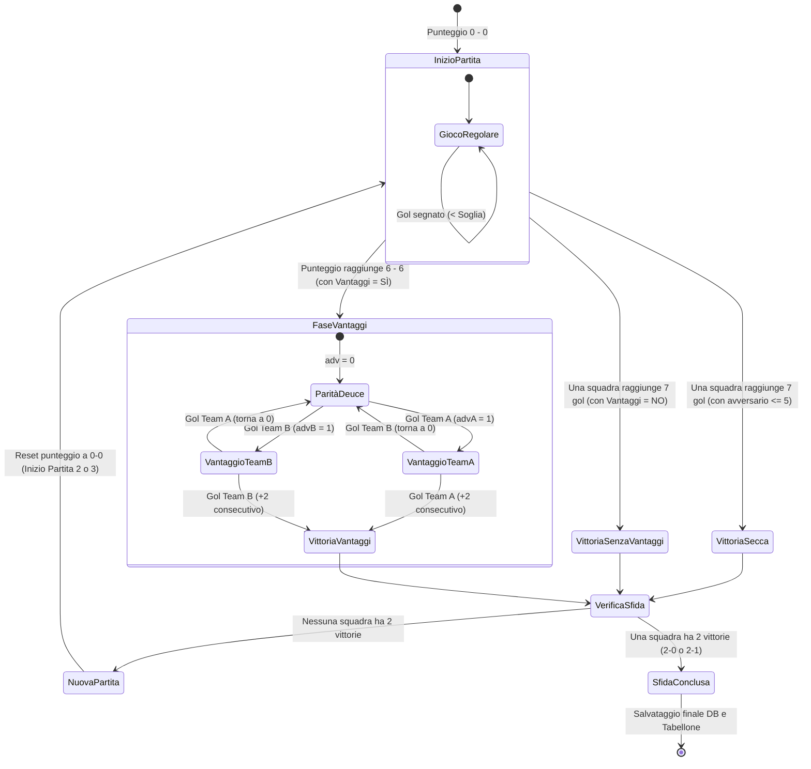

# ⚙️ Logica di Funzionamento: Vantaggi e Transizione Partite (Set)

> **Documento di Specifica Funzionale e UI/UX per Google Stitch & Team di Sviluppo.**  
> Questo documento descrive in dettaglio la logica del segnapunti digitale, la gestione dell'opzione Vantaggi (scarto di 2), le condizioni di fine set e il flusso automatico di transizione da una partita alla successiva all'interno di una sfida al meglio delle 3 partite.

---

## 1. Glossario Fondamentale

* **Partita (Set):** Il singolo set di gioco disputato fino a un limite prefissato di gol (es. 7 gol).
* **Sfida (Match):** L'incontro complessivo tra due squadre, disputato con la formula **"Al meglio delle 3 partite"** (vince la sfida chi si aggiudica per primo 2 partite).
* **Target Gol:** Il numero base di gol necessari per vincere una singola partita (configurabile tra 5, 6, 7, 8, 9, 10; default: **7 gol**).
* **Soglia Vantaggi (`advantageThreshold`):** Il punteggio di parità che fa scattare i vantaggi ad oltranza (calcolato dinamicamente come `Target Gol - 1`).

---

## 2. Configurazione e Opzione Vantaggi (SÌ / NO)

Nel pannello impostazioni del segnapunti (posto in alto a sinistra), l'arbitro o i giocatori possono impostare due parametri prima o durante il match:

```
[ GOL PER VINCERE OGNI PARTITA ]      [ VANTAGGI (SCARTO DI 2) ]
( 5 ) ( 6 ) [ 7 ] ( 8 ) ( 9 ) ( 10 )        [ SÌ ]     ( NO )
```

### 2.1 Opzione Vantaggi = SÌ (Default Federale)
* **Logica:** Per vincere la partita è obbligatorio uno scarto di almeno due reti.
* **Calcolo della Soglia:** `advantageThreshold = Target Gol - 1`.
  * Esempio con Target = 7: la soglia è **6**. Se il punteggio arriva sul **6 - 6**, scattano i vantaggi ad oltranza.
  * Esempio con Target = 6: la soglia è **5**. Sul **5 - 5** scattano i vantaggi.
* **Vittoria senza vantaggi:** Se una squadra raggiunge il Target Gol mentre l'avversario ha un punteggio inferiore alla soglia (es. **7 - 0**, **7 - 3**, **7 - 5**), la partita termina immediatamente a favore di chi ha fatto 7.

### 2.2 Opzione Vantaggi = NO (Limite Secco)
* **Logica:** Nessuno scarto obbligatorio. Chi arriva prima al Target Gol vince immediatamente il set.
* **Comportamento Tecnico:** Il sistema imposta internamente `advantageThreshold = 99` (soglia irraggiungibile).
* **Esempio:** Se il target è settato a 7 e la partita è sul 6 - 6, la squadra che segna il 7° gol vince la partita con il punteggio di **7 - 6** (Golden Goal sul pareggio).

---

## 3. Meccanica dei Vantaggi ad Oltranza (Duel HUD)

Quando l'opzione è attiva (**SÌ**) ed entrambe le squadre raggiungono la soglia di parità (es. **6 - 6** con target 7):

1. **Ingresso in Fase Vantaggi (`inAdvantages = true`):**
   * Il punteggio base numerico si blocca visivamente sul valore di parità (es. 6 - 6).
   * Compare a schermo il modulo centrale **"Vantaggi Partita N (Serve +2 consecutivo)"**.
2. **Gli Stati del Vantaggio (`advA` e `advB`):**
   * **Stato 0 - Parità (Deuce):** Nessuna squadra ha il vantaggio (`advA = 0, advB = 0`). Entrambi i box `GOL 1` e `GOL 2` sono spenti.
   * **Stato 1 - Vantaggio (+1 / Punto Partita):**
     * Se la Squadra A segna sul pareggio: `advA = 1`, `advB = 0`.
     * Il box `GOL 1 (+1)` della Squadra A si illumina intensamente e pulsa.
     * Sopra la colonna compare il badge animato: **`PUNTO PARTITA ROSSO (+1)`**.
     * Se in questo momento la Squadra B segna un gol: il vantaggio della Squadra A viene annullato e si torna in parità perfetta (`advA = 0, advB = 0`).
   * **Stato 2 - Vittoria del Set (+2):**
     * Se la Squadra con il vantaggio a +1 segna il secondo gol consecutivo: `advA = 2`.
     * Si illumina il box `GOL 2` con l'icona del trofeo.
     * La squadra conquista la partita.

---

## 4. Conclusione della Partita e Transizione al Set Successivo

Una singola partita finisce quando si verifica una delle seguenti condizioni:
1. **Target Raggiunto Senza Vantaggi:** Una squadra raggiunge il target (es. 7) e l'altra ha meno di `Target - 1` gol (es. 7-5, 7-4, 7-2, 7-0).
2. **Target Raggiunto con Opzione NO:** Una squadra raggiunge il target esatto (es. 7-6) senza scarto obbligatorio.
3. **Doppio Vantaggio Conquistato:** Una squadra raggiunge il +2 consecutivo nella fase vantaggi.

### 4.1 Il Flusso di Transizione (Passaggio da Partita 1 a Partita 2)
Appena una partita si conclude:

```
[ Fine Partita 1 (es. 7 - 4 per Rossi) ]
                    ↓
[ Registrazione Statistiche e Set nel DB/Memoria ]
                    ↓
[ Apertura Modale Inter-Set: "Partita 1 Conclusa!" ]
                    ↓
[ Click "Inizia Partita 2" ]
                    ↓
[ Reset Gol Set Corrente a 0 - 0 ]
                    ↓
[ Avanzamento Header: "Partita 2 di 3" • "1 a 0 nelle partite" ]
```

1. **Registrazione del Set Concluso:**
   * Il punteggio finale del set (es. `7 - 4` o `8 - 6`) e i gol individuali attribuiti ai giocatori vengono sigillati e salvati nell'array `completedSets`.
   * Il contatore partite vinte della squadra vincitrice si aggiorna (es. `Squadra A: 1 partita, Squadra B: 0 partite`).
2. **Modale Intermezzo tra i Set:**
   * Se nessuna squadra ha ancora raggiunto **2 partite vinte**, compare una finestra modale che annuncia il vincitore del set appena concluso e il risultato parziale della sfida.
   * Un pulsante evidente permette di avviare il set successivo.
3. **Reset per la Nuova Partita:**
   * La stecca dei gol (1-10) e i display giganti del punteggio vengono azzerati a **0 - 0**.
   * L'indicatore centrale si aggiorna automaticamente: **`In corso: Partita 2 di 3`**.
   * Se dopo due partite il punteggio è 1 a 1, si gioca la **`Partita 3 di 3 (La Bella - Decisivo)`**.

### 4.2 Conclusione Definitiva della Sfida (Match Point Finale)
* Appena una delle due squadre conquista la sua **seconda partita** (risultato finale 2-0 oppure 2-1):
  * L'intera sfida è terminata (`isMatchFinished = true`).
  * Il segnapunti disattiva tutti i pulsanti di incremento gol per evitare manomissioni accidentali.
  * Compare l'header celebrativo con coriandoli e proclamazione della coppia vincitrice.
  * Il server salva definitivamente il match su database (`Prisma.match.update`), revalida il tabellone del torneo e aggiorna le classifiche generali.

---

## 5. State Machine e Diagramma di Flusso (Mermaid)



---

## 6. Pseudocodice di Calcolo (Algoritmo React/TypeScript)

```typescript
// Parametri
const targetGoals = 7;             // Gol limite impostati (es. 7)
const isAdvantagesOn = true;        // Opzione Vantaggi (SÌ / NO)
const advantageThreshold = isAdvantagesOn ? targetGoals - 1 : 99; // 6 se ON, 99 se OFF

// Valutazione sequenza gol nel set
let scoreA = 0;
let scoreB = 0;
let inAdvantages = false;
let advA = 0; // 0: parità, 1: vantaggio (+1), 2: vittoria (+2)
let advB = 0;
let setWinner: "A" | "B" | null = null;

for (const goal of currentSetGoals) {
  if (setWinner) break;

  if (goal === "A") scoreA++;
  else scoreB++;

  if (!inAdvantages) {
    // Controllo ingresso vantaggi
    if (scoreA >= advantageThreshold && scoreB >= advantageThreshold) {
      inAdvantages = true;
      advA = 0;
      advB = 0;
    } 
    // Vittoria prima della soglia o senza vantaggi
    else if (scoreA >= targetGoals && scoreB < advantageThreshold) {
      setWinner = "A";
    } 
    else if (scoreB >= targetGoals && scoreA < advantageThreshold) {
      setWinner = "B";
    }
  } else {
    // Logica duello vantaggi (+2 consecutivo)
    if (goal === "A") {
      if (advB === 1) { advB = 0; advA = 0; } // Pareggio
      else if (advA === 0) { advA = 1; }      // Vantaggio +1
      else if (advA === 1) { advA = 2; setWinner = "A"; } // Vittoria set!
    } else {
      if (advA === 1) { advA = 0; advB = 0; } // Pareggio
      else if (advB === 0) { advB = 1; }      // Vantaggio +1
      else if (advB === 1) { advB = 2; setWinner = "B"; } // Vittoria set!
    }
  }
}
```

---

## 7. Linee Guida UI per Google Stitch

1. **Indicatori Vantaggi Sempre Coerenti:** Se i vantaggi sono su `NO`, l'interfaccia non deve mai mostrare la scritta "Punto Partita" o il modulo HUD dei vantaggi, ma deve semplicemente illuminare la vittoria appena un punteggio tocca il target impostato.
2. **Numeri Tabulari sui Punteggi:** Utilizzare font con spaziatura fissa (`tabular-nums`) per evitare che il layout sobbalzi quando il punteggio passa da numeri a singola cifra a doppia cifra (es. 9 a 10).
3. **Pulsante di Reset d'Emergenza:** Deve essere sempre garantito il tasto *"Annulla Ultimo Gol (-)"* che consente di ricalcolare deterministicamente lo stato precedente anche se la partita era entrata nella fase vantaggi.
